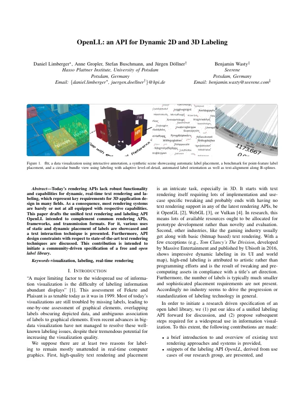
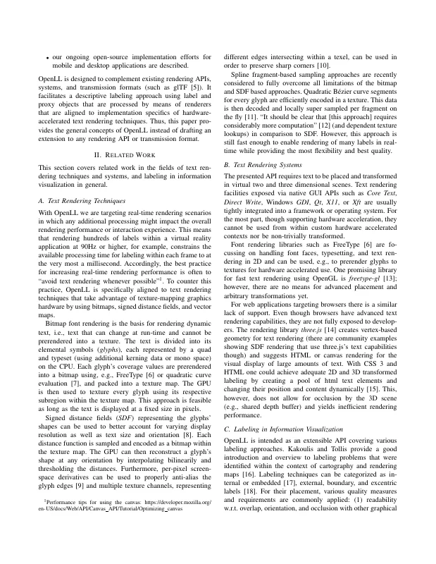
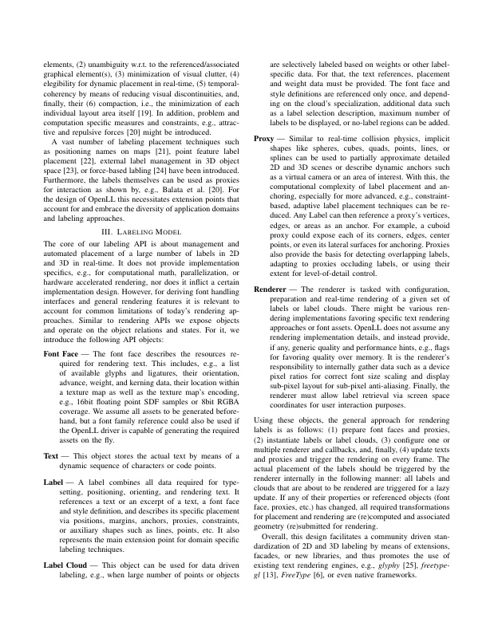
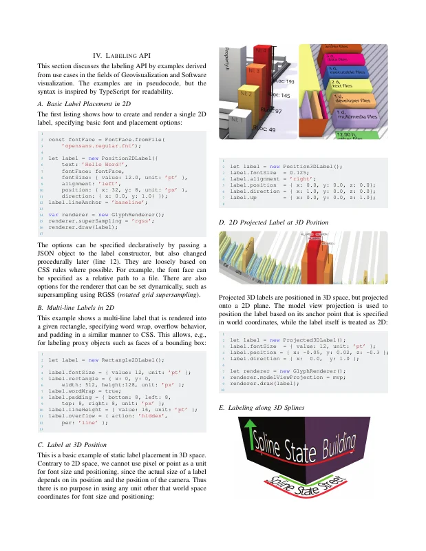
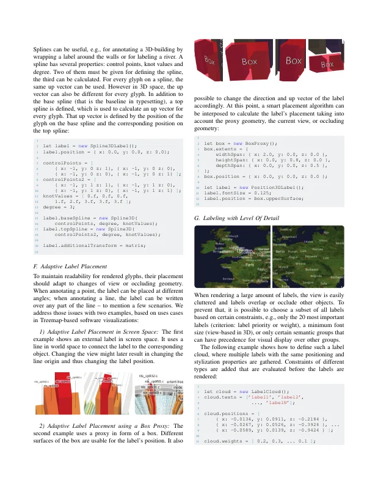
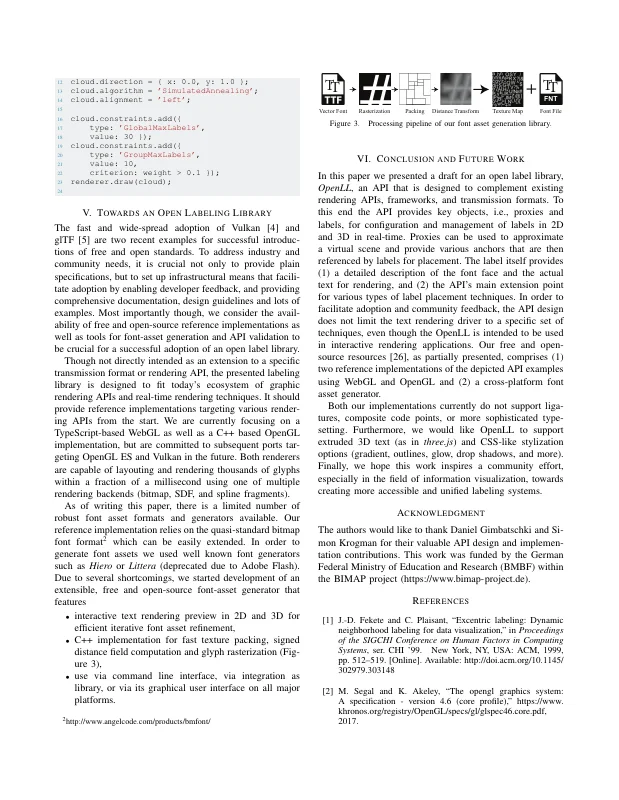
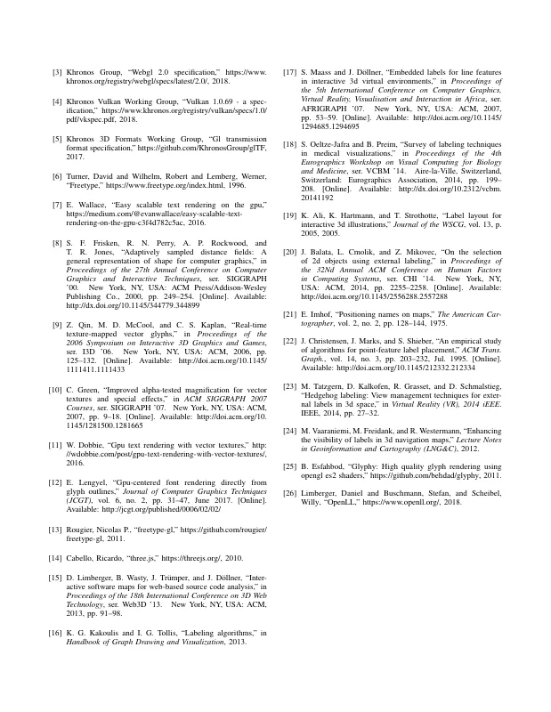

# OpenLL: An API for Dynamic 2D and 3D Labeling

[Daniel Limberger](https://orcid.org/0000-0002-9111-4809), Anne Gropler, [Stefan Buschmann](https://orcid.org/0000-0001-9854-7810), Benjamin Wasty, and [Jürgen Döllner](https://orcid.org/0000-0002-8981-8583)

*22nd International Conference Information Visualisation (IV '18)*, July 10–13, 2018, Fisciano, Italy. IEEE, pp. 175–181.

DOI: [10.1109/iV.2018.00039](https://doi.org/10.1109/iV.2018.00039) · Author's version: [Zenodo](https://doi.org/10.5281/zenodo.24176588) · [ResearchGate](https://www.researchgate.net/publication/327017928)

Implementation: [cginternals/openll](https://github.com/cginternals/openll) (API specification, reference implementations) · [cginternals/openll-cpp](https://github.com/cginternals/openll-cpp) (C++ implementation)

> Today's rendering APIs lack robust functionality and capabilities for dynamic, real-time text rendering and labeling, which represent key requirements for 3D application design in many fields.
> As a consequence, most rendering systems are barely or not at all equipped with respective capabilities.
> This paper drafts the unified text rendering and labeling API OpenLL intended to complement common rendering APIs, frameworks, and transmission formats.
> For it, various uses of static and dynamic placement of labels are showcased and a text interaction technique is presented.
> Furthermore, API design constraints with respect to state-of-the-art text rendering techniques are discussed.
> This contribution is intended to initiate a community-driven specification of a free and open label library.

<p><a href="limberger2018-openll-as-submitted.pdf"></a> <a href="limberger2018-openll-as-submitted.pdf"></a> <a href="limberger2018-openll-as-submitted.pdf"></a> <a href="limberger2018-openll-as-submitted.pdf"></a></p>
<details><summary>Remaining 3 pages</summary><p><a href="limberger2018-openll-as-submitted.pdf"></a> <a href="limberger2018-openll-as-submitted.pdf"></a> <a href="limberger2018-openll-as-submitted.pdf"></a></p></details>

## Contents

- [`src/`](src/) – LaTeX sources of the camera-ready version (IEEE conference template, `IEEEtran.cls` V1.7a, `compsocconf`)
- [`limberger2018-openll-as-submitted.pdf`](limberger2018-openll-as-submitted.pdf) – camera-ready PDF as submitted to IEEE CPS (2018-05-25)
- [`build.sh`](build.sh) – reproducible build with TeX Live 2017 (podman or docker)
- [`preview/`](preview/) – page previews for this README

## Build

```bash
./build.sh        # → build/iv2018-147.pdf
```

`IEEEtran.cls` (V1.7a) is bundled in `src/` and takes precedence over the TeX Live version.
`limberger2018-openll-as-submitted.pdf` was built with pdfTeX 1.40.18 (TeX Live 2017); the build reproduces it pixel-identically.

## Versions

- [`v1.0-camera-ready`](https://github.com/dl-archive/article.2018-iv-open-ll/tree/v1.0-camera-ready) – sources as submitted to IEEE

## Citation

```bibtex
@InProceedings{limberger2018-openll,
  author    = {Limberger, Daniel and Gropler, Anne and Buschmann, Stefan and Wasty, Benjamin and D{\"o}llner, J{\"u}rgen},
  booktitle = {22nd International Conference Information Visualisation},
  title     = {OpenLL: An API for Dynamic 2D and 3D Labeling},
  year      = {2018},
  series    = {IV~'18},
  publisher = {IEEE},
  pages     = {175--181},
  doi       = {10.1109/iV.2018.00039},
  isbn      = {978-1-538672-02-0},
}
```
